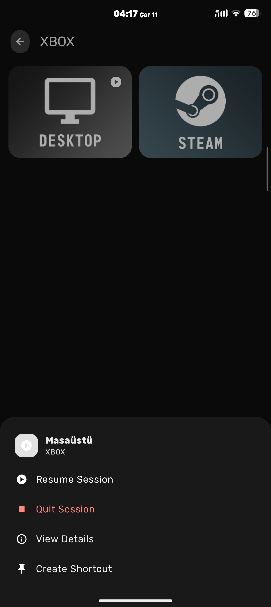
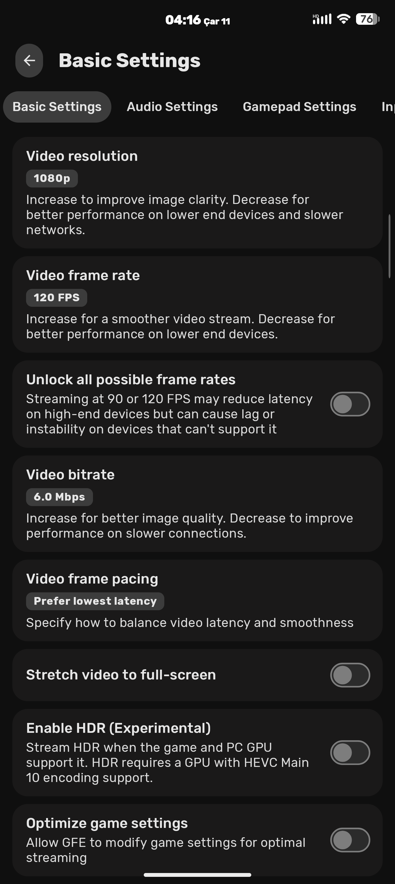
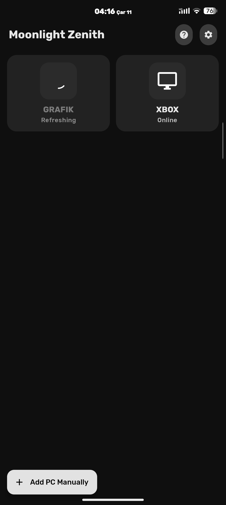
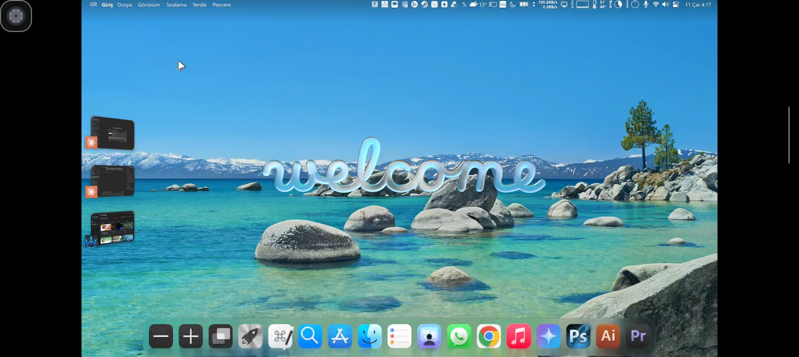
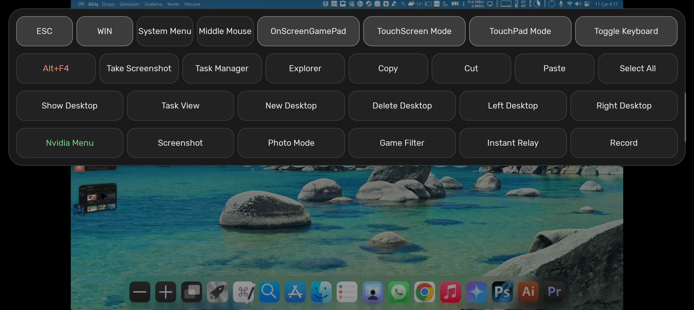

# Moonlight Zenith

**Moonlight Zenith** is a modernized, feature-rich fork of [Moonlight Android](https://github.com/moonlight-stream/moonlight-android) featuring a complete **Material Design 3 (Material You)** interface, a **bulletproof multi-language keyboard & punctuation engine**, **in-stream floating quick actions**, **enhanced on-screen controls**, and **sensor-driven landscape orientation**.

## ✨ What's in the box?

### 🎨 Material Design 3 (Material You) UI & Theme Engine
- **Complete Material 3 Overhaul**: Modernized every screen (`PcView`, `AppView`, `StreamSettings`, `AddComputerManually`, `Game`), dialog, context menu, switch, slider, and HUD overlay using Material Design 3 components and tonal surfaces.
- **Dual Theme Engine + Independent Pure Black (AMOLED) Toggle**:
  - **Material You (Dynamic)**: Extracts dynamic wallpaper colors on Android 12+ (`API 31+`) and applies them cohesively across app backgrounds, cards, switches, system status/navigation bars, and the in-stream floating menu.
  - **Zenith Indigo**: Custom Material 3 Dark palette with Indigo/Violet primary accents (`#BAC3FF`) and layered tonal surface containers.
  - **Pure Black Background (AMOLED)**: An independent toggle right below the theme selector that applies a true `#000000` OLED black background to **either** Material You or Zenith Indigo.
- **Soft Indigo-Tinted Moonlight Icon**: Retains the iconic Moonlight silhouette softly tinted with a refined slate-indigo (`#52597A`) and ice-indigo (`#EEF0FF`) palette across launcher, adaptive, TV banner, and shortcut icons.

### 🎮 In-Stream Floating Menu, Sensor Landscape & Touch Enhancements
- **Sensor-Driven Landscape Auto-Rotation**: Automatically switches between normal landscape and reverse landscape in real time using the device's physical orientation sensor while connecting and streaming—even when Android's system auto-rotate is turned off.
- **Material 3 In-Stream Floating Menu (Attect)**: Glassmorphic M3 floating ball and quick-action panel that adapts to Material You / Zenith Indigo colors, offering one-tap access to `ESC`, `WIN`, `Alt+F4`, Task Manager, Copy/Cut/Paste, Virtual Desktops, Nvidia Overlay, On-Screen Gamepad hotplugging, TouchScreen/TouchPad mode switching, and keyboard toggle.
- **Touch & On-Screen Controller Refinements**:
  - Live mid-stream On-Screen Gamepad hotplug arrival events.
  - Sub-pixel coordinate accumulation for smooth, precise TouchPad cursor movement.
  - Configurable long-press right-click (`300ms`–`1000ms`) in Native Touch mode.
  - Dedicated `L3`/`R3` buttons and symmetric on-screen controller clusters.

### 🗂️ Swipeable Tabbed Settings & Reorganized Categories
- **Swipeable Pill TabBar (`TabLayout` + `ViewPager2`)**: Navigate settings categories effortlessly by swiping horizontally anywhere on the page or tapping the scrollable Material 3 pill tabs.
- **Borderless M3 Preference Cards**: Custom borderless preference rows (`M3SwitchPreference`, `M3ListPreference` with tonal active-value badges and radio single-choice dialogs, and M3 slider dialogs) with zero divider lines and smooth view recycling.
- **8 Logical Settings Categories**:
  1. **Video Settings**: Resolution, frame rate, bitrate, frame pacing, full-screen stretch, PIP, HDR, full range, and codec selection.
  2. **Audio Settings**: Surround sound configuration, audio effects, and equalizer.
  3. **Gamepad Settings**: Controller vibration, face button flip, motion sensor support, gamepad mouse emulation, built-in USB driver, and Home/Guide key injection.
  4. **Input & Keyboard Settings**: Host PC keyboard layout selector, touchscreen trackpad mode, mouse navigation buttons, remote desktop (absolute mouse) mode, and stylus support.
  5. **On-Screen Controls Settings**: Virtual controller overlay, haptic feedback, L3/R3-only mode, Guide button visibility, opacity slider, and layout reset (all sub-options remain freely editable even when always-on OSC is turned off).
  6. **Host Settings**: Automatic game settings optimization, play audio on PC, and mute PC speakers while streaming.
  7. **Interface & Theme Settings**: App theme (`Material You` / `Zenith Indigo`), Pure Black (AMOLED) toggle, sensor-driven landscape auto-rotation, small icon mode, and app language.
  8. **Advanced Settings**: Unlock all frame rates, disable warnings, IPv6 support, performance stats overlay, and verbose logging.

### 🖥️ Symmetric PC & App Grids with Smart Cover Art Centering
- **Unified Card Geometry**: PC and App grids share identical outer `MaterialCardView` dimensions (`174dp` height, `22dp` corner radius, symmetric spacing) for visual consistency.
- **Smart `CenterContentImageView`**: Automatically detects dual-tone background + silhouette cover art (such as Sunshine's default **Desktop** and **Steam** posters) and centers the artwork and title mathematically inside the card while preserving edge-to-edge cropping for full-bleed game box art.
- **Instant Online Status Updates**: PC cards immediately clear the loading spinner and `"Refreshing"` state as soon as a host responds online.
- **Adaptive Context Menus (`M3MenuHelper`)**: Opens a sleek Material 3 Modal Bottom Sheet on touch devices and a centered Material 3 Dialog on TV / D-pad setups.

### ⌨️ Bulletproof Multi-Language Keyboard & Punctuation Engine
- **Host PC Keyboard Layout Selector**: Choose between **Auto** (automatically detects from your Android device language), **Turkish (QWERTY)**, **German (QWERTZ)**, **French (AZERTY)**, **Spanish (QWERTY)**, and **Italian (QWERTY)**—applied live without restarting the stream.
- **Hardware-Level `VK_` & `VK_LSHIFT` Synchronization**:
  - Dynamically translates regional letters (`ı`, `İ`, `ğ`, `ü`, `ş`, `ö`, `ç`, `ß`, `ä`, `é`, `ñ`, etc.), single/double quotes (`'`, `"`), and number-row/punctuation symbols (`!`, `^`, `+`, `%`, `&`, `/`, `(`, `)`, `=`, `?`, `_`, etc.) to their exact Windows/Sunshine Virtual-Key (`VK_`) codes.
  - Synchronizes `VK_LSHIFT` (`0x80A0`) state with Android's virtual keyboard (`Virtual.kcm`) so unshifted host keys (like `"` on Turkish Q) never falsely trigger Shift (`é`) and shifted host keys (like `'` on Turkish Q) never fall back to US scancodes (`i`).
- **AltGr Symbol Injection & Synthetic Alt Filtering**: Directly delivers AltGr symbols (`@`, `#`, `$`, `[`, `]`, `{`, `}`, `\`, `|`, `` ` ``, `~`) via UTF-8 while swallowing synthetic `Alt` events from Android soft keyboards so Windows never triggers unwanted `Alt` menu shortcuts.

### 🌍 Comprehensive Localization
- Complete translations for all Zenith features, settings categories, themes, and in-stream menus across **29 languages** (including English, Turkish, German, French, Spanish, Italian, Chinese, Japanese, Korean, Russian, Ukrainian, Polish, Portuguese, Dutch, and more).

---

## 🙏 Credits
- Enhanced and modernized by [Google Antigravity](https://antigravity.google) in collaboration with [me](https://github.com/bcrtvkcs).
- Based on the brilliant open-source work of the original [Moonlight Android](#moonlight-android) team.
- Special thanks to the authors of the forks & commits we integrated:
  - [athlan20](https://github.com/athlan20/moonlight-android-L3R3) for the L3/R3 button support.
  - [Attect](https://github.com/Attect/moonlight-android-Attect) for their foundational in-stream floating menu and touch contributions.
- Deep thanks to the [Sunshine](https://github.com/LizardByte/Sunshine) project for enabling this ecosystem.
