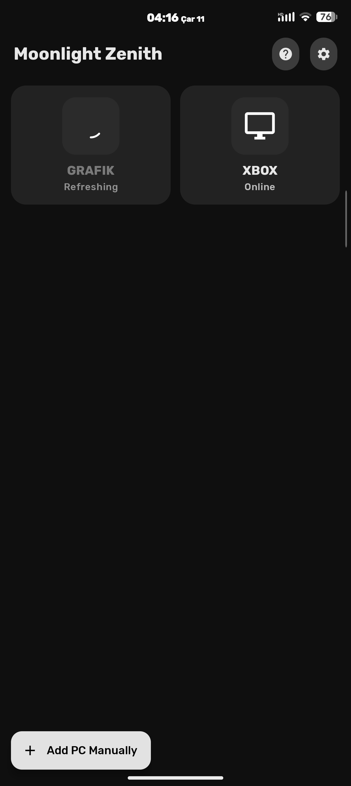
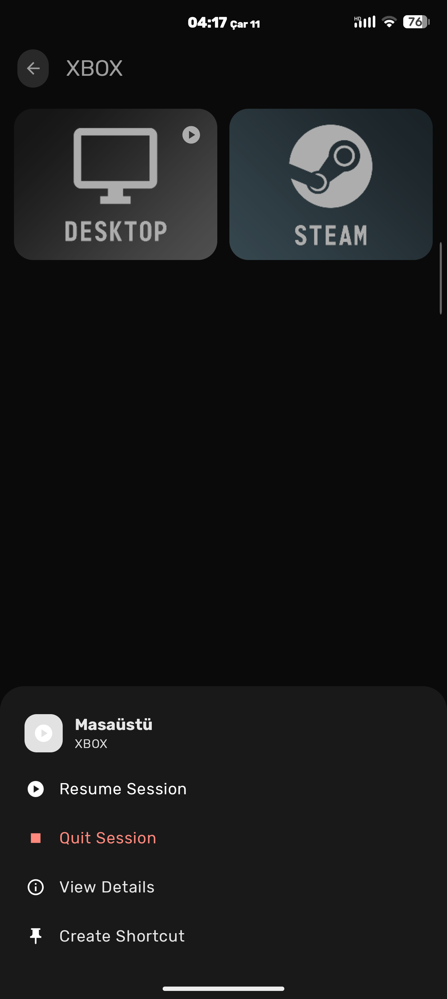

# Moonlight Zenith

**Moonlight Zenith** is a modernized, feature-rich fork of [Moonlight Android](https://github.com/moonlight-stream/moonlight-android) featuring a dual-engine **Material Design 3 (Material You Expressive)** and optional **Liquid Glass (`Kyant0/AndroidLiquidGlass`)** interface, **customizable tinted backgrounds & live wallpaper support**, an optional **floating bottom navigation bar**, **flexible multi-select audio output (Client / Host / Both / Muted)**, **Smart Keyboard Mode (Gboard glide typing & autocorrect)**, a **bulletproof multi-language keyboard & punctuation engine**, **in-stream floating quick actions**, **enhanced on-screen controls**, and **sensor-driven landscape orientation**.

## 📸 Screenshots

| PCs | Apps & Context Sheet | Settings |
| :---: | :---: | :---: |
|  |  |  |

| Desktop View | Attect Menu |
| :---: | :---: |
|  |  |

## ✨ What's in the box?

### 🫧 Optional Liquid Glass UI (`Kyant0/AndroidLiquidGlass`)
- **Dual-Engine Interface Selector**: Keep the default **Material You Expressive** XML interface or switch anytime under **UI Settings** to the full **Liquid Glass** Jetpack Compose interface powered by [`io.github.kyant0:backdrop:2.0.1`](https://github.com/Kyant0/AndroidLiquidGlass).
- **Real-Time Optical Glass Rendering**: Uses dual-layer backdrop sampling with real-time AGSL optical lens refraction (`lens`), chromatic aberration, 3D depth effect, Gaussian backdrop blur, vibrancy, specular rim highlights, and depth shadows on Android 13+ (`API 33+`), hardware `RenderEffect` blur on Android 12, and a clean translucent fallback on older devices (`minSdk 23`).
- **Complete Screen & Control Parity**:
  - Covers **`PcView`**, **`AppView`**, **`StreamSettings`**, **`AddComputerManually`**, animated modal dialogs & bottom sheets (**`GlassDialogPortal`** and **`GlassMenuOverlay`**) with full D-pad / Android TV focus navigation and edge-to-edge system bar insets.
  - Features authentic refractive **`LiquidGlassSwitch`** capsules and **`LiquidGlassSlider`** thumbs that magnify and refract the track beneath them and stay active strictly until your finger leaves the screen.
  - Renders the in-stream **Attect Overflow Menu** (`AttectGlassMenuHost`) and all **28** quick-action buttons in live Liquid Glass synced to your optical settings—keeping the game stream behind the menu 100% sharp and unblurred, while styling the floating launch badge statically for zero GPU overhead during gameplay.
- **3 Presets + 8 Fine-Grained Optical Controls & Live Preview**:
  - Switch between **Frosted Glass**, **Clear Glass**, **Tinted Glass**, or automatic **Custom Parameters** mode, and inspect changes in real time on an interactive draggable **Live Liquid Glass Preview** card.
  - Tune **Glass blur radius** (`0–32 dp`), **Lens refraction amount** (`0–72 dp`), **Lens refraction height** (`0–40 dp`), **Chromatic aberration**, **3D lens depth effect**, **Glass surface opacity** (`5–75%`), **Specular edge highlight** (`0–100%`), and **Backdrop vibrancy**.
- **Configurable Liquid Glass Refresh Rate (FPS)**: Choose **`15`**, **`30`**, **`60`**, **`90`**, **`120`**, **`144`**, or **`144+ (Unlimited)`** FPS (`FramePacedLayerBackdrop`) to balance battery efficiency and dynamic glass smoothness while keeping scrolling and touch input at your display's full native refresh rate.

### 🎨 Material Design 3 (Material You Expressive) & Theme Engine
- **Complete Material 3 Overhaul**: Modernized every screen, dialog, context menu, switch, slider, and HUD overlay using Material Design 3 components and tonal surfaces.
- **Dual Theme Engine + Independent Pure Black (AMOLED) Toggle**:
  - **Material You (Dynamic)**: Extracts dynamic wallpaper colors on Android 12+ (`API 31+`) and applies them cohesively across app backgrounds, cards, switches, system status/navigation bars, and the in-stream floating menu.
  - **Zenith Indigo**: Custom Material 3 Dark palette with Indigo/Violet primary accents (`#BAC3FF`) and layered tonal surface containers.
  - **Pure Black Background (AMOLED)**: An independent toggle right below the theme selector that applies a true `#000000` OLED black background to **either** Material You or Zenith Indigo.
- **Soft Indigo-Tinted Moonlight Icon**: Retains the iconic Moonlight silhouette softly tinted with a refined slate-indigo (`#52597A`) and ice-indigo (`#EEF0FF`) palette across launcher, adaptive, TV banner, and shortcut icons.

### 🖼️ Customizable Tinted App Background & Phone Wallpaper
- **Three Background Sources** (available in both **Liquid Glass** and **Material You Expressive** modes):
  - **Theme Default**: Clean tonal surface or adaptive ambient aurora mesh in Liquid Glass mode.
  - **Custom Image**: Modern Android Photo Picker (`PickVisualMedia`) with support for local gallery and Google Photos cloud media (plus `OpenDocument` fallback and API 28+ `ImageDecoder` handling JPEG, PNG, WebP, HEIC, AVIF, and EXIF orientation).
  - **Phone Wallpaper**: Zero-permission live system wallpaper backdrop via `FLAG_SHOW_WALLPAPER` with Android 12+ `blurBehindRadius`.
- **Full Visual Blending Controls**: Independently adjust **Background opacity** (`0–100%`), **Background color tint** (9 color/theme modes), **Tint intensity** (`0–90%`), and **Background blur** (`0–24 dp` on Android 12+) with live preview.

### 🗂️ Swipeable Settings — Tabbed or Floating Bottom Navigation Bar
- **Switchable Settings Navigation Style**: Choose live (no restart needed) between:
  - **Tabbed (Default)**: Scrollable top pill tabs (`TabLayout` + `ViewPager2` / `GlassPillTabBar` + `HorizontalPager`) with horizontal swipe navigation across categories.
  - **Floating Bottom Bar**: A spacious floating capsule dock with custom category icons across all 7 tabs—rendered as a pure Material 3 Expressive floating dock in Material You mode, or a **sliding-lens Liquid Glass capsule dock** (`LiquidFloatingBottomBar`) in Liquid Glass mode featuring elastic active-tab hold physics (+7% dock swell, dynamic horizontal shift following your finger's screen position from center, and smooth edge auto-scroll across all categories).
- **7 Logical Settings Categories**:
  1. **Basic / Video Settings**: Resolution, frame rate, bitrate, frame pacing, full-screen stretch, PIP, HDR, full range, and codec selection.
  2. **Audio Settings**: Multi-select Audio Output (**This device (Client)** and/or **PC (Host)**), surround sound configuration, audio effects, and equalizer.
  3. **Gamepad Settings**: Controller vibration, face button flip, motion sensor support, gamepad mouse emulation, built-in USB driver, and Home/Guide key injection.
  4. **Input & Keyboard Settings**: Smart Keyboard Mode, host PC keyboard layout selector, touchscreen trackpad mode, mouse navigation buttons, remote desktop (absolute mouse) mode, and stylus support.
  5. **On-Screen Controls Settings**: Virtual controller overlay, haptic feedback, L3/R3-only mode, Guide button visibility, opacity slider, and layout reset (all sub-options remain freely editable even when always-on OSC is turned off).
  6. **UI Settings**: Interface style (**Material You Expressive** / **Liquid Glass**), Liquid Glass presets, 8 optical parameters, Live Preview, Glass FPS limit, Settings navigation style (**Tabbed** / **Floating Bottom Bar**), Material 3 theme & Pure Black (AMOLED) toggle, custom background image & wallpaper blending controls, sensor-driven landscape rotation, small icon mode, and app language.
  7. **Advanced Settings**: Host game optimization, unlock all frame rates, disable warnings, IPv6 support, performance stats overlay, and verbose logging.

### 🔊 Flexible Multi-Select Audio Output
- **4 Audio Routing Modes in One Setting**: Replaces the single PC audio toggle with a 2-checkbox **Audio output** selector (**This device (Client)** and **PC (Host)**) so you can choose **Client only**, **Host only**, **Client + Host simultaneously**, or **None (Muted)**.
- **Clean Muted Client Playback (`SilentAudioRenderer`)**: When Client audio is unchecked, Moonlight Zenith avoids creating an `AudioTrack` or claiming Android system audio focus.

### 🎮 In-Stream Floating Menu, Sensor Landscape & Touch Enhancements
- **Sensor-Driven Landscape Auto-Rotation**: Automatically switches between normal landscape and reverse landscape in real time using the device's physical orientation sensor while connecting and streaming—even when Android's system auto-rotate is turned off.
- **In-Stream Floating Menu (Attect)**: Adapts to **Material You / Zenith Indigo** or **Liquid Glass** mode, offering one-tap access to **28** quick actions including `ESC`, `WIN`, `Alt+F4`, Task Manager, Copy/Cut/Paste, Virtual Desktops, Nvidia Overlay, On-Screen Gamepad hotplugging, TouchScreen/TouchPad mode switching, and keyboard toggle.
- **Touch & On-Screen Controller Refinements**:
  - Live mid-stream On-Screen Gamepad hotplug arrival events.
  - Sub-pixel coordinate accumulation for smooth, precise TouchPad cursor movement.
  - Configurable long-press right-click (`300ms`–`1000ms`) in Native Touch mode.
  - Dedicated `L3`/`R3` buttons and symmetric on-screen controller clusters.

### 🖥️ Symmetric PC & App Grids with Smart Cover Art Centering
- **Unified Card Geometry**: PC and App grids share identical card dimensions (`174dp` height, `22dp` corner radius, symmetric spacing) for visual consistency across both Material 3 and Liquid Glass modes.
- **Smart `CenterContentImageView`**: Automatically detects dual-tone background + silhouette cover art (such as Sunshine's default **Desktop** and **Steam** posters) and centers the artwork and title mathematically inside the card while preserving edge-to-edge cropping for full-bleed game box art.
- **Instant Online Status Updates**: PC cards immediately clear the loading spinner and `"Refreshing"` state as soon as a host responds online.
- **Adaptive Context Menus**: Opens an animated Modal Bottom Sheet on touch devices and a centered Dialog on TV / D-pad setups.

### ⌨️ Smart Keyboard Mode & Multi-Language Keyboard Engine
- **Opt-In Smart Keyboard Mode**: Enable **Smart keyboard mode** under **Input Settings** for full Gboard glide typing, predictive suggestions, autocorrect, and spacebar cursor swiping without a fullscreen extract editor (`StreamInputConnection` shadow-buffer diff engine routing ASCII & regional keys through low-latency `VK_` events while batching Unicode/emoji via UTF-8). Disabled by default to preserve raw key-event behavior for games.
- **Host PC Keyboard Layout Selector**: Choose between **Auto** (automatically detects from your Android device language), **Turkish (QWERTY)**, **German (QWERTZ)**, **French (AZERTY)**, **Spanish (QWERTY)**, and **Italian (QWERTY)**—applied live without restarting the stream.
- **Hardware-Level `VK_` & `VK_LSHIFT` Synchronization**:
  - Dynamically translates regional letters (`ı`, `İ`, `ğ`, `ü`, `ş`, `ö`, `ç`, `ß`, `ä`, `é`, `ñ`, etc.), single/double quotes (`'`, `"`), and number-row/punctuation symbols (`!`, `^`, `+`, `%`, `&`, `/`, `(`, `)`, `=`, `?`, `_`, etc.) to their exact Windows/Sunshine Virtual-Key (`VK_`) codes.
  - Synchronizes `VK_LSHIFT` (`0x80A0`) state with Android's virtual keyboard (`Virtual.kcm`) so unshifted host keys never falsely trigger Shift and shifted host keys never fall back to US scancodes.
- **AltGr Symbol Injection & Synthetic Alt Filtering**: Directly delivers AltGr symbols (`@`, `#`, `$`, `[`, `]`, `{`, `}`, `\`, `|`, `` ` ``, `~`) via UTF-8 while swallowing synthetic `Alt` events from Android soft keyboards so Windows never triggers unwanted `Alt` menu shortcuts.

### 🌍 Comprehensive Localization & Modern Build Pipeline
- **29 Languages**: Complete translations for Zenith features, settings categories, audio output modes, themes, and in-stream menus across 29 locales (including English, Turkish, German, French, Spanish, Italian, Chinese, Japanese, Korean, Russian, Ukrainian, Polish, Portuguese, Dutch, and more).
- **Modern Toolchain & Automated Signed Releases**: Built with **Gradle `9.9.2`**, **AGP `9.5.1`**, **NDK `r30` LTS**, **Kotlin `2.4.10`**, and **Jetpack Compose BOM `2026.09.00`**, with automated GitHub Actions CI & Release workflows publishing verified signed `nonRoot` and `root` APKs alongside `SHA256SUMS.txt`.

---

## 🙏 Credits
- Enhanced and modernized by [Google Antigravity](https://antigravity.google) in collaboration with [me](https://github.com/bcrtvkcs).
- Based on the brilliant open-source work of the original [Moonlight Android](https://github.com/moonlight-stream/moonlight-android) team.
- Special thanks to the authors of the libraries, forks & commits we integrated:
  - [Kyant0 / AndroidLiquidGlass](https://github.com/Kyant0/AndroidLiquidGlass) for the real-time Liquid Glass Compose backdrop engine (`io.github.kyant0:backdrop`).
  - [athlan20](https://github.com/athlan20/moonlight-android-L3R3) for the L3/R3 button support.
  - [Attect](https://github.com/Attect/moonlight-android-Attect) for their foundational in-stream floating menu and touch contributions.
- Deep thanks to the [Sunshine](https://github.com/LizardByte/Sunshine) project for enabling this ecosystem.
