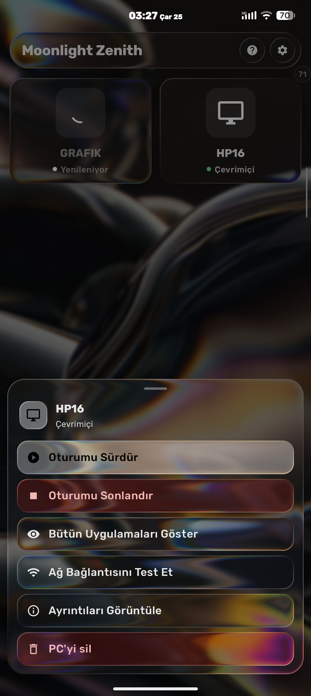
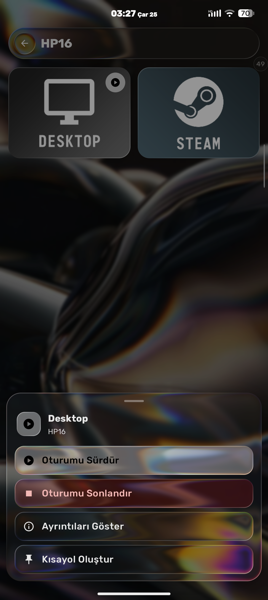
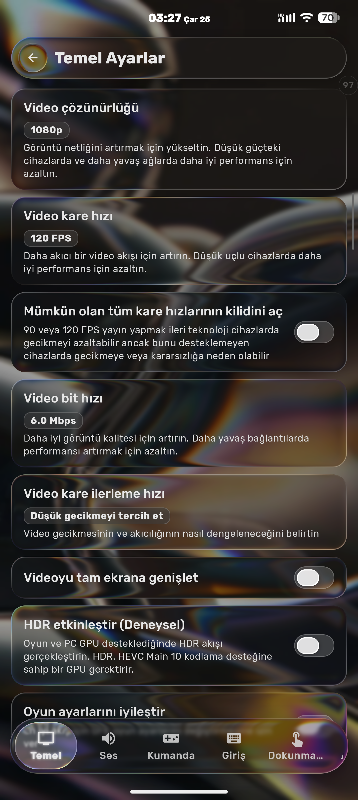
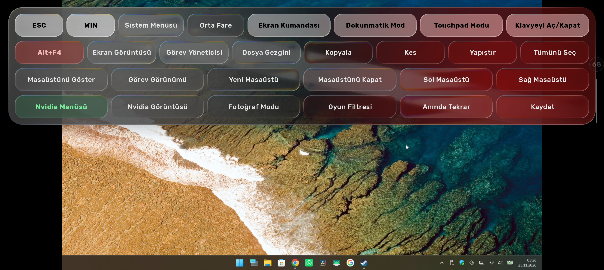
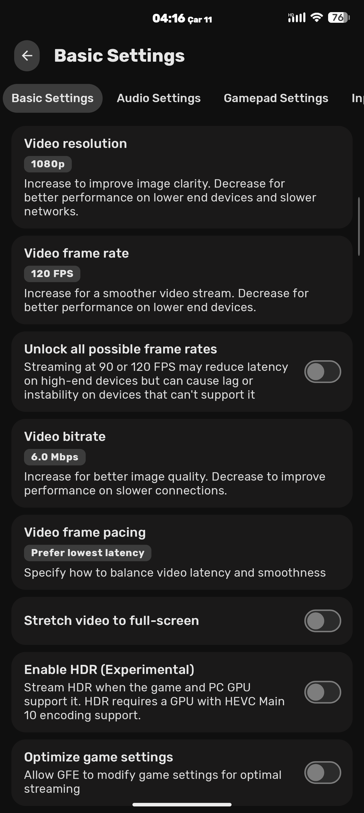
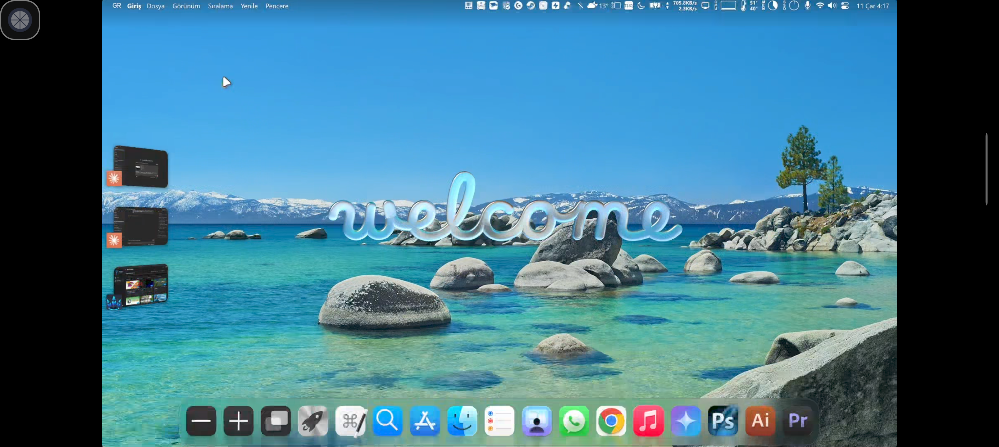
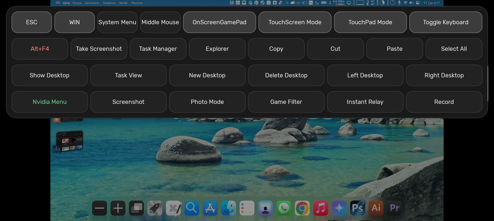

# Moonlight Zenith

**Moonlight Zenith** is a modernized fork of [Moonlight Android](https://github.com/moonlight-stream/moonlight-android) featuring **Material You** and **Liquid Glass** interfaces, customizable tinted backgrounds, a floating bottom navigation bar, flexible Client/Host audio routing, multi-language & smart keyboard input, in-stream quick actions, and sensor-driven landscape rotation.

## 📸 Screenshots

### 🫧 Liquid Glass UI

| PCs | Apps & Context Sheet | Settings |
| :---: | :---: | :---: |
|  |  |  |

| Desktop View + Attect Menu |
| :---: |
|  |

### 🎨 Material You Expressive UI

| PCs | Apps & Context Sheet | Settings |
| :---: | :---: | :---: |
|  |  |  |

| Desktop View | Attect Menu |
| :---: | :---: |
|  |  |

## ✨ Features

### 🫧 Liquid Glass UI
- **Real-Time Refractive Glass**: Switch between **Material You Expressive** and **Liquid Glass** (powered by [AndroidLiquidGlass](https://github.com/Kyant0/AndroidLiquidGlass)) across all screens, menus, dialogs, switches, sliders, and the in-stream quick menu.
- **Presets, 8 Live Controls & Preview**: Pick from **Frosted**, **Clear**, or **Tinted** presets, or fine-tune blur, refraction strength & height, chromatic aberration, 3D depth, surface opacity, edge highlight, and vibrancy with a live draggable preview.
- **Performance-Saving Glass Refresh Rate (FPS)**: Cap dynamic Liquid Glass GPU shader redraws to **`15`**, **`30`**, **`60`**, **`90`**, **`120`**, **`144`**, or **`144+ (Unlimited)`** FPS to save GPU load and battery while keeping scrolling and touch at your display's full native refresh rate.
- **Zero Gameplay Overhead**: The in-stream floating button uses a lightweight static glass look while streaming, and opening the Liquid Glass quick menu keeps the game stream behind it completely sharp and unblurred.

### 🎨 Material You Expressive UI
- **Material You Expressive** and **Zenith Indigo** themes with an independent **Pure Black (AMOLED)** toggle that works with either theme.
- **Soft Indigo App Icon** and clean symmetric PC & App grids with automatic cover art centering.

### 🖼️ Custom Background & Phone Wallpaper
- Use the **Theme Default**, pick a **Custom Image** (local gallery or Google Photos), or show your **Phone Wallpaper** directly behind the interface.
- Customize **opacity**, **color tint** (9 options), **tint intensity**, and **blur** in both Material You and Liquid Glass modes.

### 🗂️ Tabbed or Floating Bottom Settings
- **7 Swipeable Categories**: Video, Audio, Gamepad, Input & Keyboard, On-Screen Controls, UI, and Advanced.
- Switch live between classic **Tabbed** navigation and a **Floating Bottom Bar** with smooth press-and-drag tab scrubbing.

### 🔊 Flexible Audio Output
- Independently toggle **This device (Client)** and **PC (Host)** audio to route sound to **Client only**, **Host only**, **Both simultaneously**, or **None (Muted)**—without claiming system audio focus when Client audio is off.

### 🎮 In-Stream Quick Menu, Rotation & Touch
- **28-Action Floating Menu (Attect)**: One-tap access to `ESC`, `WIN`, `Alt+F4`, Task Manager, Copy/Cut/Paste, Virtual Desktops, Nvidia Overlay, On-Screen Gamepad toggle, Touch/TouchPad switching, and keyboard toggle.
- **Sensor-Driven Landscape Rotation**: Automatically flips between normal and reverse landscape while streaming, even when system auto-rotate is disabled.
- **Touch & On-Screen Controls**: High-precision TouchPad cursor tracking, configurable long-press right-click (`300ms`–`1000ms`), dedicated `L3`/`R3` buttons, and live mid-stream gamepad hotplugging.

### ⌨️ Multi-Language & Smart Keyboard
- **Host PC Keyboard Layouts**: **Auto**, **Turkish**, **German**, **French**, **Spanish**, and **Italian**—with accurate regional letters, quotes, punctuation, and AltGr symbols without triggering unintended Windows `Alt` shortcuts.
- **Smart Keyboard Mode**: Opt-in support for Gboard glide typing, suggestions, autocorrect, and spacebar cursor swiping while keeping low-latency raw key events as the default for gaming.

### 🌍 29 Languages
- Localized across **29 languages** including English, Turkish, German, French, Spanish, Italian, Chinese, Japanese, Korean, Russian, Ukrainian, Polish, Portuguese, Dutch, and more.

---

## 🙏 Credits
- Enhanced and modernized by [Google Antigravity](https://antigravity.google) in collaboration with [me](https://github.com/bcrtvkcs).
- Based on the open-source work of the original [Moonlight Android](https://github.com/moonlight-stream/moonlight-android) team.
- Special thanks to:
  - [Kyant0 / AndroidLiquidGlass](https://github.com/Kyant0/AndroidLiquidGlass) for the Liquid Glass backdrop engine.
  - [athlan20](https://github.com/athlan20/moonlight-android-L3R3) for L3/R3 button support.
  - [Attect](https://github.com/Attect/moonlight-android-Attect) for the in-stream floating menu and touch contributions.
- Thanks to the [Sunshine](https://github.com/LizardByte/Sunshine) project for enabling this ecosystem.
